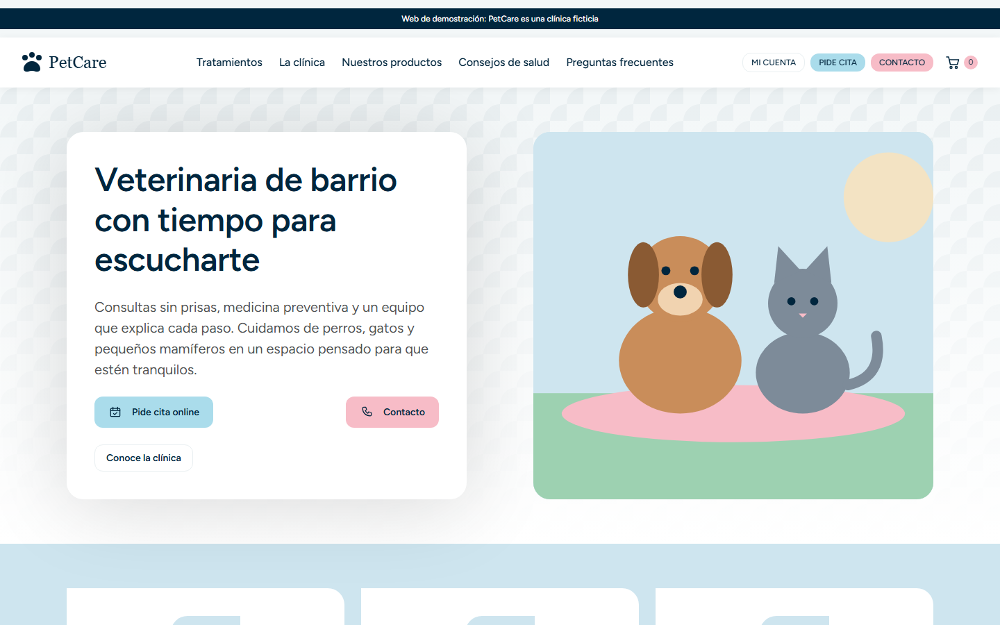
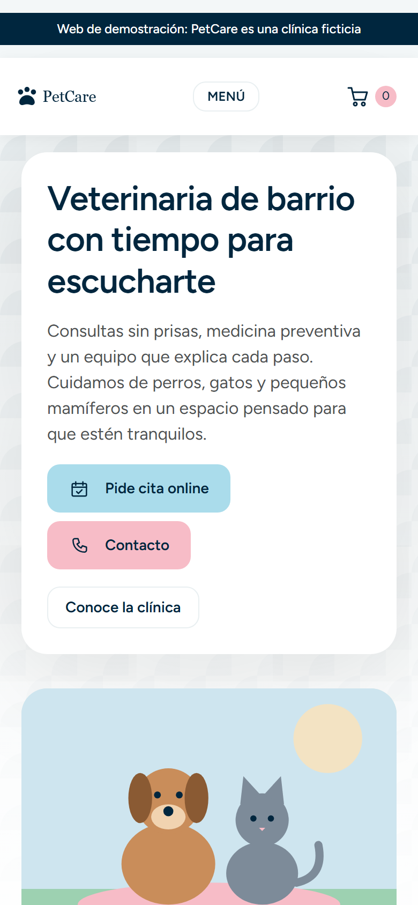
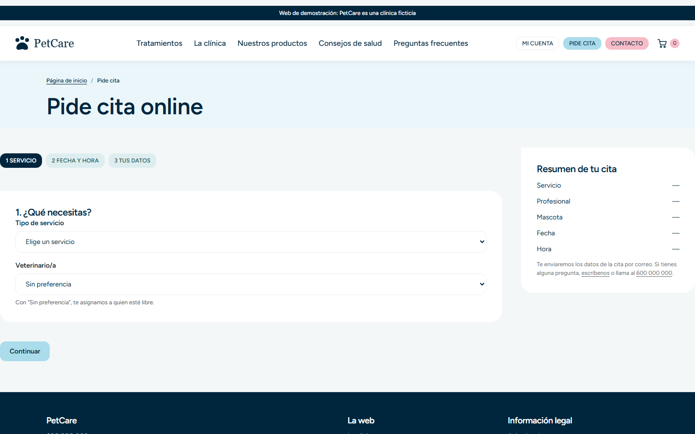
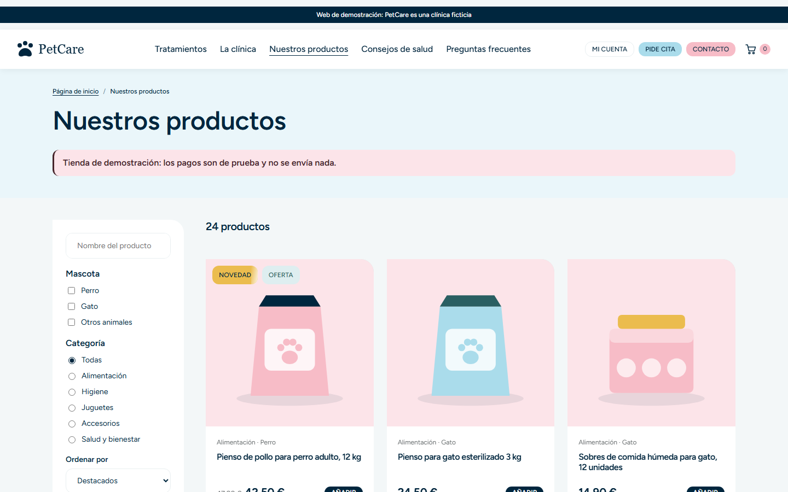
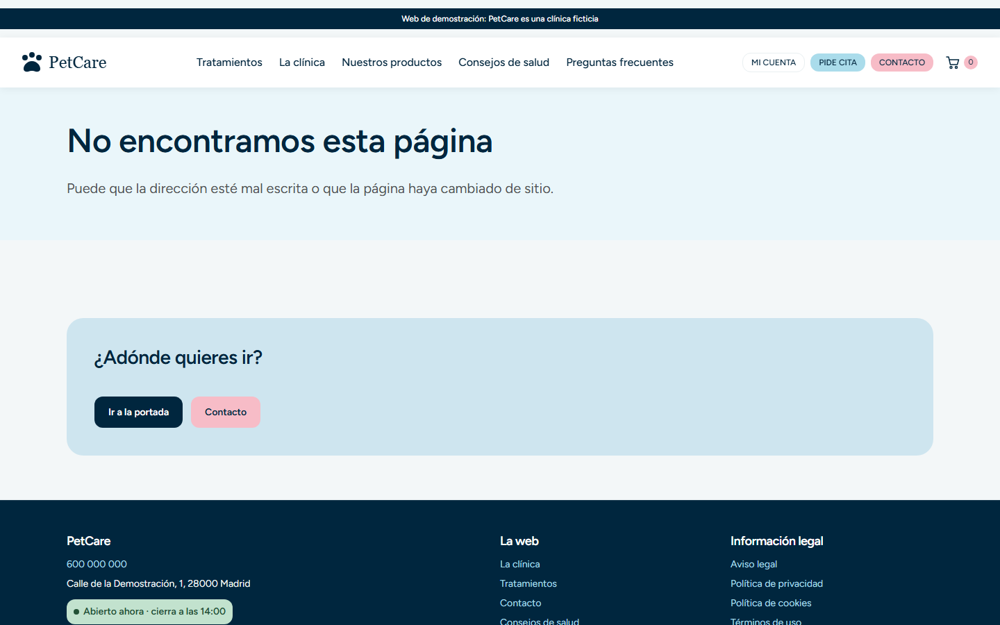
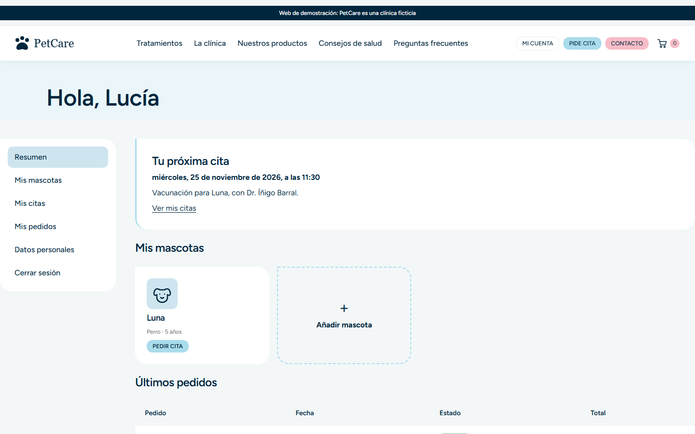
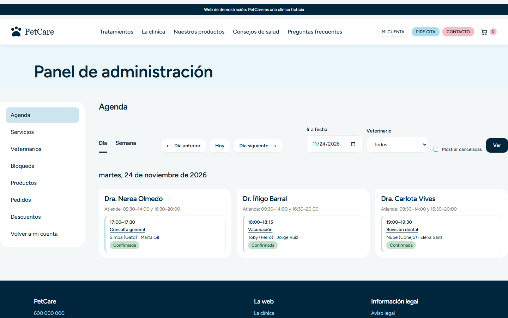
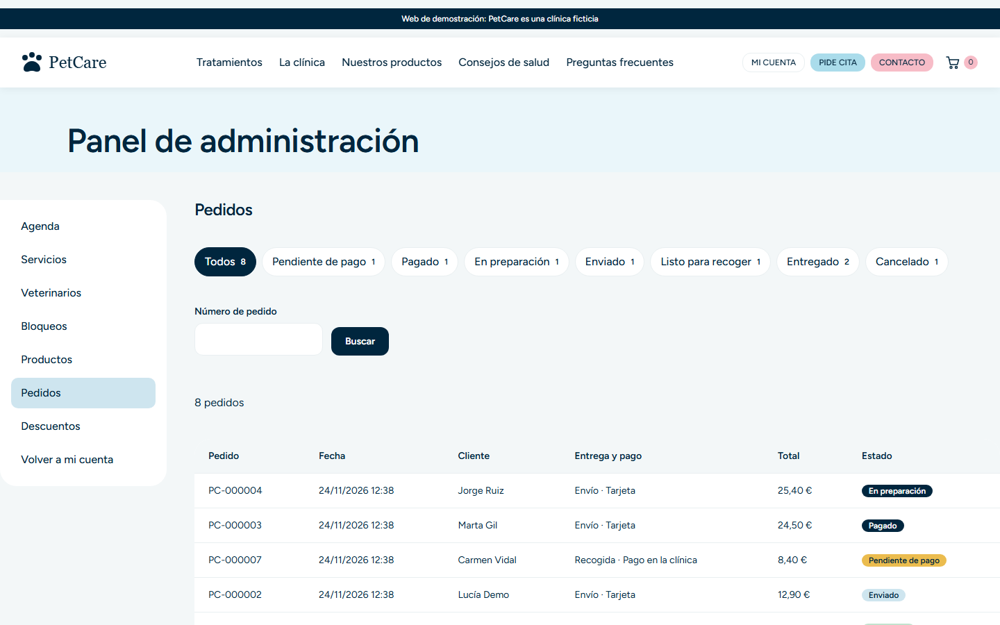
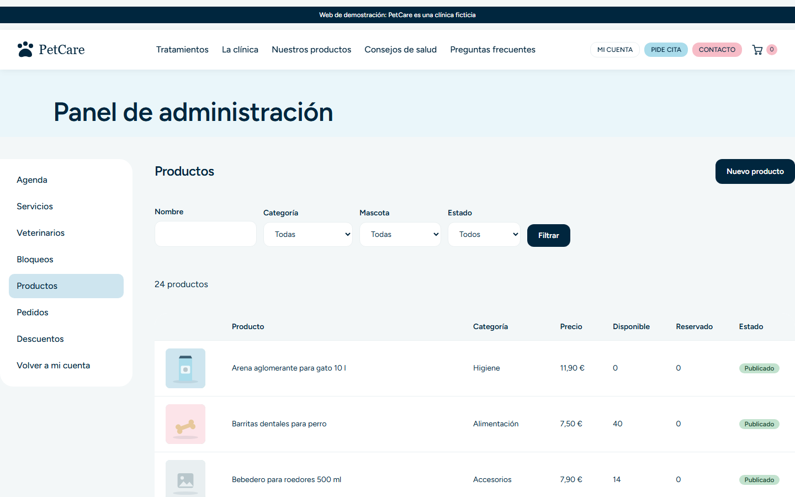

# PetCare — web de clínica veterinaria

[](https://github.com/RoberPs/petcare-clinica-veterinaria/actions/workflows/ci.yml)
[](https://codespaces.new/RoberPs/petcare-clinica-veterinaria?quickstart=1)

Producto web completo para una clínica veterinaria: web pública, cuentas de cliente con sus
mascotas, reserva de citas online, tienda con carrito y pago, consejos de salud con boletín y un
panel de administración para la agenda y la tienda. Está en español y pensado sobre todo para el
móvil.

Se presenta con **PetCare**, una clínica **ficticia**, pero el producto no es una maqueta: todo
funciona de punta a punta con datos persistentes, y sirve para cualquier clínica cambiando solo su
archivo de contenido, sin tocar el código.



## Pruébalo en 1 clic (GitHub Codespaces)

1. Pulsa **Abrir en GitHub Codespaces** (arriba) y luego **Create codespace**.
2. Espera unos minutos: el codespace instala las dependencias, crea la base de datos, carga la
   clínica de demostración y compila la app.
3. Se abre **PetCare** en el puerto 3000. Si no se abre solo, ve a la pestaña **Ports** y abre el
   **3000**.

| Cuenta | Correo | Contraseña |
|---|---|---|
| Cliente (con una mascota, dos citas y dos pedidos) | `cliente@example.com` | `PetCare-Demo-2026` |
| Administración (`/admin`) | `admin@example.com` | `PetCare-Demo-2026` |

- **Pagos**: pasarela simulada (`/pago-simulado`), sin tarjetas ni Stripe. No se cobra nada.
- **Correos**: no salen de verdad; un proveedor falso los guarda. Puedes verlos en la pestaña
  **Ports** → puerto **8025** → `/emails` (por ejemplo, el de confirmación de una cita o de un pedido).
- **Datos de ejemplo**: la agenda trae citas para los próximos días y la tienda, pedidos en todos
  los estados (pendiente de pago, pagado, en preparación, enviado, listo para recoger, entregado y
  cancelado). Están creados con los mismos flujos que usa la web, y los nombres son ficticios.
- Cada codespace es una instancia privada: los datos que metas solo los ves tú. Hace falta una
  cuenta de GitHub, y el uso consume la cuota gratuita de Codespaces de quien lo abre.

Qué probar: reservar una cita como cliente y verla en la agenda del panel, comprar en la tienda y
cambiar el estado del pedido desde `/admin`, o navegar con el teclado y con JavaScript desactivado.

## Capturas

| Móvil | Reserva de cita |
|---|---|
|  |  |

| Tienda | Consejos de salud |
|---|---|
|  |  |

| Área de cliente | Panel: agenda del día |
|---|---|
|  |  |

| Panel: pedidos | Panel: productos y stock |
|---|---|
|  |  |

## Qué incluye

| Módulo | Feature |
|---|---|
| Web pública: portada, tratamientos, la clínica, contacto, preguntas frecuentes y páginas legales | [001](specs/001-public-clinic-website/) |
| Cuentas de cliente y mascotas: registro con verificación de correo, sesión y recuperación de contraseña | [002](specs/002-client-accounts-pets/) |
| Reserva de citas online, con huecos reales por veterinario y sin solapes | [003](specs/003-online-appointment-booking/) |
| Catálogo de la tienda con filtros, búsqueda y ficha de producto | [004](specs/004-product-catalog/) |
| Carrito, checkout y pago (Stripe Checkout en modo de pruebas o pasarela simulada) | [005](specs/005-cart-checkout/) |
| Consejos de salud y boletín con doble confirmación | [006](specs/006-health-tips-newsletter/) |
| Panel de administración de la agenda: servicios, veterinarios, horarios y bloqueos | [007](specs/007-admin-agenda-panel/) |
| Panel de administración de la tienda: productos y fotos, stock, pedidos y códigos de descuento | [008](specs/008-admin-store-panel/) |

## Cómo está hecho

**Desarrollo guiado por especificación** con [Spec Kit](https://github.com/github/spec-kit) y
Claude Code. Cada feature pasa por especificar → aclarar → planificar → desglosar en tareas →
implementar, y deja en [`specs/`](specs/) su spec, su plan, las decisiones técnicas razonadas
(`research.md`), el modelo de datos, los contratos y las tareas. En total, 8 features y más de 650
tareas. Todas se comprueban contra la [constitución](.specify/memory/constitution.md) del
proyecto, que fija principios no negociables:

- **Design system como única fuente visual**: solo [`design/tokens.css`](design/tokens.css) y
  [`design/styles.css`](design/styles.css). Un comprobador en el lint prohíbe CSS fuera de
  `design/`, valores escritos a mano y el atributo `style`.
- **Accesibilidad WCAG 2.2 AA** y **todo funciona sin JavaScript**: menú, formularios con Server
  Actions y POST-Redirect-GET, carrito, pago y panel.
- **Privacidad (RGPD) y seguridad**: consentimiento de cookies en el que rechazar cuesta lo mismo
  que aceptar, sin recursos de terceros antes del consentimiento, validación con Zod en el
  servidor, Argon2id, CSP con nonce, protección CSRF, límites de intentos y logs sin datos
  personales.
- **Producto adaptable**: ningún dato de una clínica concreta en `src/`. Todo sale de
  [`content/petcare.yaml`](content/petcare.yaml) (cargado en la base de datos) o del entorno.
- **Fiabilidad**: correos con bandeja de salida transaccional y reintentos, formularios
  idempotentes, stock reservado durante el pago y estados de pedido con transiciones controladas.
- **Rendimiento**: Lighthouse móvil de 90 o más en la portada y el catálogo.

### Stack

- **Next.js 15** (App Router, React Server Components y Server Actions), **React 19** y
  **TypeScript** estricto, sobre Node.js 22.
- **PostgreSQL 16** con **Drizzle ORM** y 8 migraciones versionadas (`btree_gist` para impedir
  citas solapadas a nivel de base de datos).
- **Zod**, **pino**, **`@js-temporal/polyfill`** (fechas en `Europe/Madrid`) y **sharp** (fotos
  de producto en WebP).
- Correo con **Brevo** y pagos con **Stripe Checkout**, los dos por API HTTP, sin SDK, y con
  proveedores falsos para el desarrollo, los tests y esta demo.

### Tests y CI

Unas 180 suites: **Vitest** (unitarias e integración contra PostgreSQL real), **Playwright** con
**axe** en tres perfiles (móvil, escritorio y sin JavaScript) y **Lighthouse CI**. La
[CI de GitHub Actions](.github/workflows/ci.yml) las pasa todas en cada cambio.

## Estructura del repositorio

```text
.specify/          Spec Kit: constitución, plantillas y scripts
.devcontainer/     demo en GitHub Codespaces (PostgreSQL, correo falso y cuentas de demostración)
design/            design system (tokens y componentes) y maquetas HTML de referencia
specs/             una carpeta por feature: spec, plan, research, data model, contracts y tasks
src/               aplicación Next.js (app, components, domain, db, content, email, lib)
content/           contenido de la clínica ficticia (content/petcare.yaml)
drizzle/           migraciones de PostgreSQL
scripts/           migraciones, carga de contenido, correo, pedidos, administración y comprobaciones
tests/             unit, integration y e2e
deploy/            referencia de un despliegue en producción (Docker Compose, Caddy, systemd)
```

## Ejecutarlo en local

Requisitos: Node.js 22 y Docker.

```bash
cp .env.example .env      # rellena FORM_SECRET y los datos del responsable
docker compose up -d      # PostgreSQL (5434), PostgreSQL de pruebas (5433) y el correo falso
npm ci
npm run db:migrate
npm run content:load -- --file content/petcare.yaml
PETCARE_DEMO=1 npm run demo:seed   # opcional: las cuentas de demostración de arriba
npm run dev               # http://localhost:3000
```

```bash
npm run lint              # ESLint, tsc y check:design
npm test                  # unitarias
npm run test:integration  # PostgreSQL real
npm run test:e2e          # Playwright y axe
npm run test:lighthouse   # Lighthouse CI (requiere npm run build)
npm run admin -- grant <correo> --by "<quién>"   # rol de administración del panel
```

La carpeta [`deploy/`](deploy/README.md) documenta cómo se desplegaría en producción en un VPS
(Docker Compose detrás de Caddy y Cloudflare, copias de seguridad y tareas programadas). No está
desplegada: la demo pública es el codespace.

## Aviso

PetCare es una clínica **ficticia**. Cualquier parecido con una clínica real es casual. La web lo
indica en todas sus páginas, y la tienda no vende ni envía nada.

## Licencia

[MIT](LICENSE). Las imágenes, los textos y los datos de la clínica ficticia se incluyen solo como
contenido de demostración.
